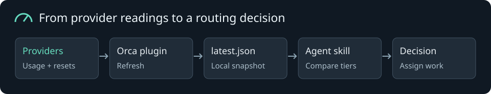
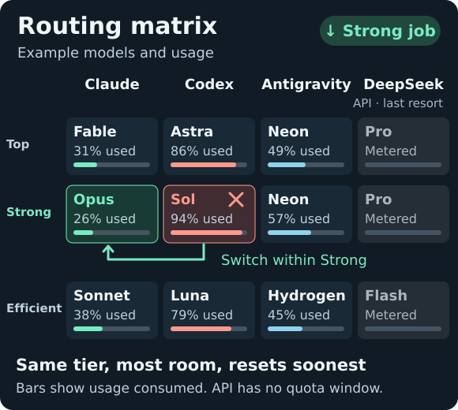
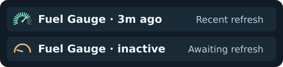

# 

Fuel Gauge pairs an Orca status-bar plugin with an agent skill. The plugin reads provider allowances and reset times. When an orchestrating agent assigns a job, the skill helps it find a model at the requested tier on a provider with enough room to finish. Use subscriptions before their allowances reset and save metered APIs for last.



## Adaptive routing

The orchestrator chooses the tier. The skill compares usage windows, recent burn rate and upcoming resets across eligible subscriptions. For example, a Strong job can move from Codex to Claude when the Codex window is nearly spent. If no subscription can carry the job at its tier, the orchestrator presents the options to the owner before downgrading or spending money. The skill's model table is illustrative and should be updated for your account.



## Supported providers

| Provider | Reading | Local prerequisite |
| --- | --- | --- |
| Claude | Five-hour, weekly and supported model-specific usage | Claude Code OAuth login file |
| Codex / ChatGPT | Subscription windows or monthly spend-control percentage | Codex signed in with ChatGPT |
| Antigravity / Gemini | Quota by model pool | Native Antigravity login and agy 1.1.11 or newer with read-only /usage |
| DeepSeek | API balance by currency | Existing key in ~/.config/deepseek/api_key |

## Install

From the repository root, with Orca 1.4.248 or newer, run:

```sh
orca plugin install ./plugin
```

Review the trusted-worker access shown by Orca. Repeat the command with the fingerprint it prints:

```sh
orca plugin install ./plugin --approve <fingerprint>
```

If disabled, run `orca plugin enable local.fuel-gauge`, then repeat with `--approve <fingerprint>` using the fingerprint for that operation. Replace the angle-bracket placeholders before running.

Link the skill into your agent's skills directory. For an agent using the shared skills folder:

```sh
mkdir -p ~/.agents/skills
ln -s "$PWD/skill" ~/.agents/skills/fuel-gauge
```

Keep the checkout in place. The reader requires Bash and Python 3. Run `./skill/scripts/read-usage.sh` to inspect a reading.

## Refresh and configuration



Click the gauge or run **Fuel Gauge: Refresh now**. The interval in plugin settings defaults to 15 minutes with a five-minute minimum. The bar becomes inactive after 1.5 refresh intervals. Its age describes the last snapshot write. Check each provider's status for individual failures.

To skip providers, create a JSON array at `~/.local/share/fuel-gauge/ignored-providers.json`, for example `["antigravity", "deepseek"]`. Remove an ID to resume collection.

## Snapshot format

The plugin atomically replaces `~/.local/share/fuel-gauge/latest.json`. This fictional snapshot has one configured provider. Percentages measure usage consumed and reset timestamps use UTC.

```json
{
  "updatedAt": "2026-01-01T10:00:00Z",
  "refreshMinutes": 15,
  "providers": {
    "codex": {
      "setUp": true, "ok": true, "lastOkAt": "2026-01-01T10:00:00Z", "error": null,
      "windows": [{"name": "5h", "usedPercent": 23, "resetsAt": "2026-01-01T12:00:00Z", "minutes": 300}]
    }
  }
}
```

Balance readings include a `balances` array of currency and total pairs. A failed reading includes an error and the last successful timestamp if known. Ignored providers are omitted.

## Privacy and limitations

The plugin uses local logins. Direct authenticated requests go only to the corresponding provider host and reject redirects. Antigravity delegates to the local provider CLI. Some usage endpoints are unofficial and may change. A missing login, incompatible CLI or changed response can leave a provider without a reading. The skill keeps up to 500 local history entries and tracks providers that stop reporting. Treat snapshots, balances and transcripts as private. See [Security](SECURITY.md).

## FAQ

**Does the plugin launch jobs?** The orchestrating agent makes the routing decision. The status bar collects readings and supports manual refresh.

**Can the skill run without the plugin?** When a snapshot is absent or older than twice its refresh interval, the reader checks local Codex session logs and Claude limit rejections. Antigravity quota and DeepSeek balance then require an owner-supplied reading.

## Contributing and license

See [contributing guidelines](CONTRIBUTING.md) and the [changelog](CHANGELOG.md). Released under the [MIT License](LICENSE).
